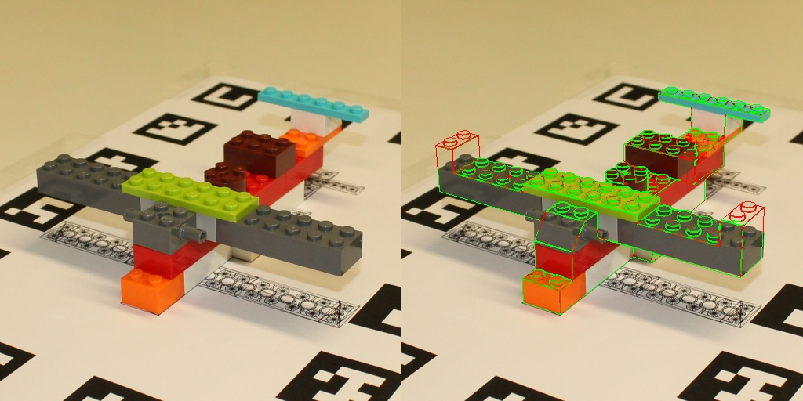

# PIXIE, reimplemented, plus an assembly check

A from-scratch reimplementation of **PIXIE** (ZEISS, [arXiv 2607.16015](https://arxiv.org/abs/2607.16015)): 6D pose of an
object from **one RGB photo and its untextured CAD model**, with no training on the object. The paper shows the pose
stays robust when the object is assembled wrong, but it does not say *whether* it is assembled wrong. This repository
adds that step: render the CAD model at the estimated pose and check, part by part, whether the photo confirms it.

Everything is evaluated on the public [PIXIE dataset](https://github.com/ZEISS/PIXIE-dataset) (4 LEGO models, 695
photos; correct, recoloured, cluttered and wrongly assembled scenes), following its zero-shot rules.



*Left: photo. Right: edges of the CAD model at the estimated pose; green = confirmed by the photo, red = not. The two
red 2×2 bricks are absent from the real assembly.*

## Results

### Pose (695 images, RTX 4060)

| | median ADD | ADD < 1 cm | ADD < 2 cm | rotation > 90° off |
|---|---|---|---|---|
| PIXIE paper | 0.36 cm | 73.5 % | | |
| **This repo, no ground truth at inference** | **0.32 cm** | **88.6 %** | 90.4 % | 7.2 % |
| This repo, crop from the gt pose (not allowed, reference only) | 0.29 cm | 94.4 % | 97.6 % | 1.6 % |

Per scenario, ADD < 1 cm without ground truth: color 96.2 %, clutter 88.8 %, assembly mistake 92.0 %, assembly mistake
with clutter 75.3 %. When the pose is right, it lines up with the photo to about 2 px (median reprojection error in the
512 px object crop; 1.8 px on color scenes, 2.5 px on mistake + clutter).

The gap to the oracle crop is almost entirely gross failures (rotation more than 90° off: 7.2 % against 1.6 %), not
lost precision, and it sits mostly in cluttered scenes. 4 images get no pose at all.

### Assembly check (same 695 images, poses from the run above)

| AUROC (0.5 = chance) | estimated pose | gt pose (analysis) |
|---|---|---|
| scene: defective vs correct, all views pooled (25 / 23 scenes) | **0.920** | 0.955 |
| single image | 0.846 | 0.881 |
| single image, no clutter / clutter | 0.914 / 0.764 | 0.933 / 0.827 |
| missing part, per image (AP 0.54, base rate 0.23) | 0.744 | 0.763 |

Pose error costs only a few points. The main false positives are the two `clutter2` scenes (model 2 and 4), where the
coarse pose failed: when nothing lines up, the check calls the scene defective. A pose-confidence gate would likely fix
this, but it was not added after seeing these numbers (see Protocol). Per-scene scores: [docs/defect_scenes.csv](docs/defect_scenes.csv).

On the synthetic defects used for tuning, the same parameters give part AUROC 0.94 and image AUROC 0.83: images
transfer well, part localisation loses ground on real photos.

## Method

**Pose**, following the paper:
1. Reference set: the CAD model rendered from 121 directions × 8 in-plane rolls, as normal maps and depth maps, with a
   small PyTorch rasteriser (no OpenGL needed). Each pixel keeps the model-frame 3D point under it.
2. SuperPoint + LightGlue with MINIMA's cross-modal weights match the photo crop against every reference.
3. Matched reference keypoints are lifted to 3D; RANSAC PnP (1000 iterations, 5 px) on the best references.
4. View re-selection: also try the reference closest to the estimated pose, keep the better.

**Where is the object?** The paper assumes the 2D detection is given. Here it comes from the scene, with no ground
truth: ArUco markers on the board give the work area and, from their known size, the expected image size of the object.
The markers are painted out, a coarse pose is estimated on the whole area, and the frozen pipeline runs on a tight crop
around it.

**Assembly check:**
- Render the target at the estimated pose in an undistorted crop. Its geometric edges (silhouette, depth steps > 2 mm,
  creases > 30°) are assigned to the part in front.
- An edge pixel is *confirmed* when the photo has a gradient of the same orientation within `tol_px`. A missing brick
  leaves its edges unconfirmed; what the camera sees there instead is a brick height away.
- Part score = share of unconfirmed edge pixels. Image score = worst part. Scene score: edges pooled over all views first.
- Parts are the connected components of the CAD mesh (studs, tubes, walls).

**Tuning, on synthetic data only:** `scripts/tune_defects.py` makes defects on the target model itself (bricks removed,
added or moved on the LEGO grid), renders them as crude photos (flat brick colours, shading, paper background with
loose bricks, blur, noise, JPEG) at a perturbed pose (~3 px error, like the real estimator) and grid-searches the 4
parameters on 480 views. The result, `tol_px=2, norm_q=50, min_edge=20, region_mm=0`, was frozen before any real image
was checked.

## Protocol

The dataset is test-only. What this repo does with it:
- **At inference:** only the fully assembled target model, the camera calibration, the photo and the board marker size.
  The `modelN_poses.json` entry that places the object on the board is ground truth and is never read.
- **Ground-truth poses and as-built meshes:** scoring only. The `--box oracle` and `--gt-pose` options exist for
  analysis and are labelled as such above.
- **No training or tuning on the dataset.** The pose configuration (normal + depth references, matcher, RANSAC
  settings, coarse stage) was fixed before the full runs; a 12-image and a 24-image run on the dataset served only to
  check that the code ran, and nothing was changed after them. The assembly check was tuned on synthetic renders only.
- **External pretrained weights:** SuperPoint and LightGlue/MINIMA, trained on other data; nothing is trained here.
- **Defect labels:** the target parts with no identical part (same vertices) in the scene's as-built mesh. Extra bricks
  have no part-level label, so the part AUROC only measures missing parts.

## Limits

- 4 LEGO models. Studs make matching and edge checks easier than smooth industrial parts would.
- Clutter is the weak spot of both the pose (75 % < 1 cm with defects + clutter) and the check (image AUROC 0.76).
- The work area relies on the ArUco board of this dataset; another setup needs another detector.
- About 20 s per image on an RTX 4060 (coarse stage included), against 3.6 s on an RTX 4090 in the paper; nothing
  here is optimised for speed.

## Reproduce

```bash
pip install torch opencv-contrib-python trimesh scipy numpy "lightglue @ git+https://github.com/cvg/LightGlue"
# dataset: github.com/ZEISS/PIXIE-dataset ; matcher weights: MINIMA's sp_lg checkpoint (github.com/LSXI7/MINIMA)
python scripts/run_eval.py <dataset>/dataset <minima_lightglue.pth> out/board_both.csv --modes normal depth --box board
python scripts/report.py out/board_both.csv
python scripts/tune_defects.py <dataset>/dataset out/tune --n 120 --seed 0
python scripts/eval_defects.py <dataset>/dataset out/board_both.csv out/tune/defect_params.json out/defects_board
```

| file | role |
|---|---|
| `pixie/render.py` | GPU rasteriser: depth, normals, model-frame points, face ids |
| `pixie/references.py`, `matching.py`, `pose.py` | reference set, matcher, PnP and view re-selection |
| `pixie/detect.py` | work area from the ArUco board |
| `pixie/parts.py`, `defects.py` | parts of the CAD model, edge confirmation and scores |
| `pixie/synth.py`, `scripts/tune_defects.py` | synthetic defects and parameter search |
| `scripts/eval_defects.py`, `report.py`, `reproj.py` | evaluation |

## Credits

PIXIE method and dataset: Carl Zeiss AG (dataset under BSD-3-Clause; the images in `docs/` come from it). SuperPoint:
Magic Leap (its weights carry a non-commercial licence). LightGlue: ETH Zurich CVG. MINIMA weights: their authors.
