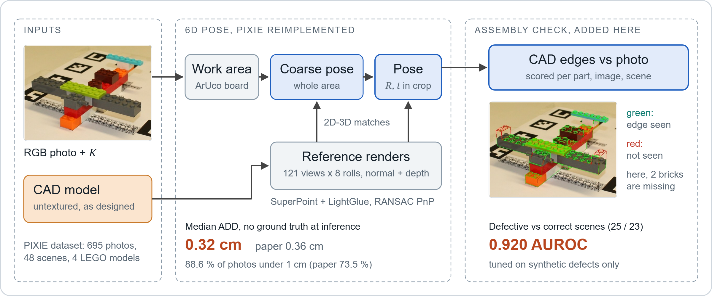
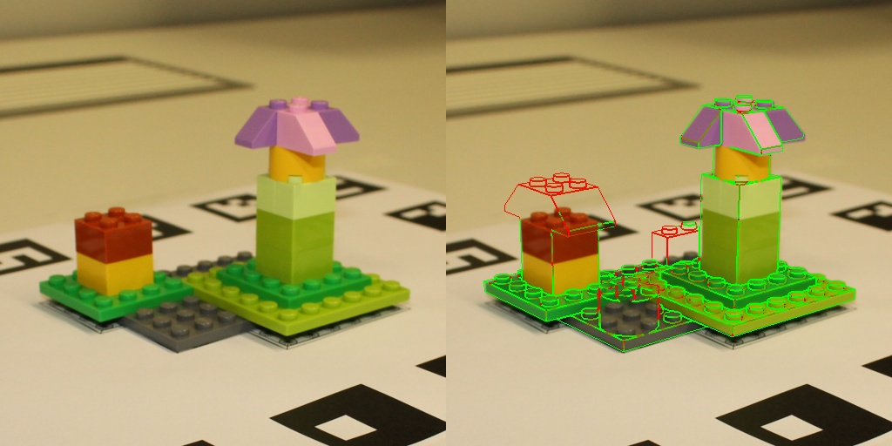

# PIXIE reimplemented: zero-shot 6D pose from one RGB photo, plus a per-part assembly check

[Paper (arXiv 2607.16015)](https://arxiv.org/abs/2607.16015) · [Dataset](https://github.com/ZEISS/PIXIE-dataset) · [Method and detailed results](docs/method.md)



A from-scratch reimplementation of PIXIE (6D pose from one RGB image and an untextured CAD model, no training on the object). It reaches 0.32 cm median ADD on the 695 photos of the public PIXIE dataset without ground truth at inference (paper: 0.36 cm), and adds a check that flags wrongly assembled scenes at 0.920 scene AUROC.

## Method

The PIXIE paper (Carl Zeiss AG) shows that pose stays accurate when the object is assembled wrong, but not whether it is assembled wrong. This repository reimplements the pose pipeline (reference renders of the CAD model, SuperPoint + LightGlue matching with MINIMA weights, RANSAC PnP), replaces the paper's given 2D detection with a localisation from the ArUco board, and adds the check: render the CAD model at the estimated pose and test, part by part, whether the photo has a matching edge. Ground-truth poses are never read at inference. Settings and file locations: [`docs/method.md`](docs/method.md).

Written here: the rasteriser, reference set, pose estimator, board localisation, assembly check, synthetic-defect tuning and evaluation. Reused: the method (PIXIE paper), the dataset (ZEISS, BSD-3-Clause), and pretrained SuperPoint, LightGlue and MINIMA weights. Nothing is trained in this repository.

## Results

Pose, 695 images, one run, RTX 4060. ADD = mean distance of model points (cm).

| | median ADD (cm) | ADD < 1 cm | ADD < 2 cm | rotation > 90 deg off |
| :-- | --: | --: | --: | --: |
| PIXIE paper (RTX 4090) | 0.36 | 73.5 % | | |
| This repo, no ground truth at inference | **0.32** | **88.6 %** | 90.4 % | 7.2 % |
| This repo, crop from the gt pose (reference only) | 0.29 | 94.4 % | 97.6 % | 1.6 % |

Assembly check, same images, poses from the run above (AUROC, 0.5 = chance):

| | estimated pose | gt pose (analysis) |
| :-- | --: | --: |
| Scene: defective vs correct, all views pooled (25 / 23 scenes) | **0.920** | 0.955 |
| Single image | 0.846 | 0.881 |
| Single image, no clutter / clutter | 0.914 / 0.764 | 0.933 / 0.827 |
| Missing part, per image (AP 0.54, base rate 0.23) | 0.744 | 0.763 |



*Left: photo. Right: CAD edges at the estimated pose; green = confirmed by the photo, red = not. The red bricks are absent from the real assembly.*

Per-scenario numbers, the scene-score plot and the main failure case (coarse pose lost in two cluttered scenes) are in [`docs/method.md`](docs/method.md#results-in-more-detail). Only the per-scene CSV ([`docs/defect_scenes.csv`](docs/defect_scenes.csv)) is committed; the per-image outputs under `out/` are regenerated by the commands below.

## Install and quick start

Run on one NVIDIA RTX 4060 (8 GB). The evaluation scripts require CUDA.

```bash
pip install torch opencv-contrib-python trimesh scipy numpy matplotlib "lightglue @ git+https://github.com/cvg/LightGlue"
```

Data and weights: the [PIXIE dataset](https://github.com/ZEISS/PIXIE-dataset) and MINIMA's `sp_lg` LightGlue checkpoint from [LSXI7/MINIMA](https://github.com/LSXI7/MINIMA).

```bash
python scripts/run_eval.py <dataset>/dataset <minima_lightglue.pth> out/board_both.csv --modes normal depth --box board   # pose, about 20 s per image
python scripts/report.py out/board_both.csv                                       # ADD metrics per scenario and model
python scripts/tune_defects.py <dataset>/dataset out/tune --n 120 --seed 0        # synthetic defects -> out/tune/defect_params.json
python scripts/eval_defects.py <dataset>/dataset out/board_both.csv out/tune/defect_params.json out/defects_board   # scene, image, part AUROC
python scripts/make_fig_scene_scores.py                                           # docs/scene_scores.svg, no dataset or GPU needed
```

## Code structure

| Path | Role |
| :-- | :-- |
| [`pixie/render.py`](pixie/render.py) | GPU rasteriser: depth, normals, model-frame points, face ids |
| [`pixie/references.py`](pixie/references.py), [`matching.py`](pixie/matching.py), [`pose.py`](pixie/pose.py) | Reference set, SuperPoint + LightGlue, PnP and view re-selection |
| [`pixie/detect.py`](pixie/detect.py) | Work area from the ArUco board |
| [`pixie/parts.py`](pixie/parts.py), [`defects.py`](pixie/defects.py), [`synth.py`](pixie/synth.py) | CAD parts, edge confirmation, synthetic defects |
| [`scripts/`](scripts/) | Evaluation, tuning, reports, figure |

## Limitations

- 4 LEGO models. Studs make matching and edge checks easier than smooth industrial parts would.
- Clutter is the weak spot of both the pose (75 % < 1 cm with defects + clutter) and the check (image AUROC 0.76).
- The work area relies on the ArUco board of this dataset; another setup needs another detector.
- About 20 s per image on an RTX 4060, against 3.6 s on an RTX 4090 in the paper; nothing is optimised for speed.
- One run, no spread across seeds or reference sets; extra bricks have no part-level label, so the part AUROC only measures missing parts.

## Citation, credits and license

Please cite the original method:

```bibtex
@misc{jungemeyer2026pixie,
  author = {Jungemeyer, Leon and Maga{\~n}a, Alejandro and Mohan, Gautham and Karl, Matthias and Werdehausen, Daniel},
  title  = {{PIXIE}: A Zero-Shot texture-invariant 6D pose estimation framework for unseen objects with assembly defects},
  year   = {2026},
  eprint = {2607.16015},
  archivePrefix = {arXiv}
}
```

PIXIE method and dataset: Carl Zeiss AG (dataset under BSD-3-Clause; the images in `docs/` come from it). SuperPoint: Magic Leap (its weights carry a non-commercial licence). LightGlue: ETH Zurich CVG (Apache-2.0). MINIMA weights: their authors (repository under Apache-2.0).

Code: MIT, see [`LICENSE`](LICENSE). Dataset images and third-party weights keep their own licences. Clément Dumeril · [clement.dumeril.net](https://clement.dumeril.net)
