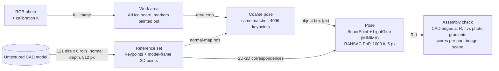

# PIXIE reimplemented: zero-shot 6D pose from one RGB photo, plus a per-part assembly check

A from-scratch reimplementation of PIXIE (6D pose from one RGB image and an untextured CAD model, no training on the object) that reaches 0.32 cm median ADD on the 695 photos of the public PIXIE dataset without ground truth at inference, and adds a check that flags wrongly assembled scenes at 0.920 scene AUROC.

[Paper (arXiv 2607.16015)](https://arxiv.org/abs/2607.16015) · [Dataset](https://github.com/ZEISS/PIXIE-dataset) · [Method details](docs/method.md)


*Left: photo. Right: edges of the CAD model at the estimated pose; green = confirmed by the photo, red = not. The two red 2x2 bricks are absent from the real assembly.*

## Overview

The PIXIE paper (Carl Zeiss AG) shows that pose stays accurate when the object is assembled wrong, but it does not say whether it is assembled wrong. This repository reimplements the pose pipeline and adds that step: render the CAD model at the estimated pose and check, part by part, whether the photo confirms it. Everything is evaluated on the public PIXIE dataset (4 LEGO models, 695 photos in 48 scenes: correct, recoloured, cluttered and wrongly assembled) under its zero-shot rules.

The code is written from scratch: the rasteriser, the reference set, the pose estimator, the board-based object localisation that replaces the paper's given detection, the assembly check, the synthetic-defect tuning and the evaluation. Reused: the method (PIXIE paper), the dataset (ZEISS, BSD-3-Clause), and pretrained SuperPoint, LightGlue and MINIMA weights. Nothing is trained in this repository.



*Ground-truth poses are never read at inference. Settings and file locations: [`docs/method.md`](docs/method.md).*

## Results

Pose, 695 images, one run, RTX 4060. ADD = mean distance of model points (cm).

| | median ADD (cm) | ADD < 1 cm | ADD < 2 cm | rotation > 90 deg off |
| :-- | --: | --: | --: | --: |
| PIXIE paper (RTX 4090) | 0.36 | 73.5 % | | |
| This repo, no ground truth at inference | 0.32 | 88.6 % | 90.4 % | 7.2 % |
| This repo, crop from the gt pose (not allowed, reference only) | 0.29 | 94.4 % | 97.6 % | 1.6 % |

ADD < 1 cm per scenario without ground truth: color 96.2 %, clutter 88.8 %, assembly mistake 92.0 %, assembly mistake with clutter 75.3 %. The gap to the oracle crop is almost entirely gross failures (rotation more than 90 deg off), mostly in cluttered scenes. 4 images get no pose. When the pose is right, it lines up with the photo to about 2 px (median reprojection error in the 512 px crop).

Assembly check, same 695 images, poses from the run above:

| AUROC (0.5 = chance) | estimated pose | gt pose (analysis) |
| :-- | --: | --: |
| Scene: defective vs correct, all views pooled (25 / 23 scenes) | 0.920 | 0.955 |
| Single image | 0.846 | 0.881 |
| Single image, no clutter / clutter | 0.914 / 0.764 | 0.933 / 0.827 |
| Missing part, per image (AP 0.54, base rate 0.23) | 0.744 | 0.763 |


*Per-scene scores from [`docs/defect_scenes.csv`](docs/defect_scenes.csv), plotted by [`scripts/make_fig_scene_scores.py`](scripts/make_fig_scene_scores.py). The two high correct scenes are `clutter2` of models 2 and 4.*

Pose error costs only a few points of AUROC. The main false positives are those two `clutter2` scenes, where the coarse pose failed: when nothing lines up, the check calls the scene defective. A pose-confidence gate would likely fix this, but it was not added after seeing these numbers. The check was tuned on synthetic defects only (part AUROC 0.94, image AUROC 0.83 there): images transfer well, part localisation loses ground on real photos.

Only the per-scene CSV is committed. The per-image pose and check outputs (`out/board_both.csv`, `out/defects_board/`) are produced by the commands below but are not in the repository yet.

## Installation

Run on one NVIDIA RTX 4060 (8 GB). The evaluation scripts require CUDA.

```bash
pip install torch opencv-contrib-python trimesh scipy numpy matplotlib "lightglue @ git+https://github.com/cvg/LightGlue"
```

Data and weights: the [PIXIE dataset](https://github.com/ZEISS/PIXIE-dataset) and MINIMA's `sp_lg` LightGlue checkpoint from [LSXI7/MINIMA](https://github.com/LSXI7/MINIMA).

## Usage

```bash
# pose on all 695 images, about 20 s per image; one CSV row per image
python scripts/run_eval.py <dataset>/dataset <minima_lightglue.pth> out/board_both.csv --modes normal depth --box board
# median ADD, < 1 cm, < 2 cm, > 90 deg per scenario and model, next to the paper's 0.36 cm / 73.5 %
python scripts/report.py out/board_both.csv
# synthetic defects and the 4-parameter search -> out/tune/defect_params.json
python scripts/tune_defects.py <dataset>/dataset out/tune --n 120 --seed 0
# assembly check: prints scene, image and part AUROC; writes images.csv and scenes.csv
python scripts/eval_defects.py <dataset>/dataset out/board_both.csv out/tune/defect_params.json out/defects_board
```

## Reproducing figures

```bash
python scripts/make_fig_scene_scores.py   # docs/scene_scores.svg from docs/defect_scenes.csv; prints scene AUROC 0.920
```

No dataset or GPU is needed for this one. The check images in `docs/` come from `scripts/eval_defects.py` (renamed).

## Code structure

| Component | File | Role |
| :-- | :-- | :-- |
| Rasteriser | [`pixie/render.py`](pixie/render.py) | GPU depth, normals, model-frame points, face ids |
| References, matching, pose | [`pixie/references.py`](pixie/references.py), [`matching.py`](pixie/matching.py), [`pose.py`](pixie/pose.py) | Reference set, SuperPoint + LightGlue, PnP and view re-selection |
| Object localisation | [`pixie/detect.py`](pixie/detect.py) | Work area from the ArUco board |
| Assembly check | [`pixie/parts.py`](pixie/parts.py), [`defects.py`](pixie/defects.py) | CAD parts, edge confirmation, scores |
| Tuning | [`pixie/synth.py`](pixie/synth.py), [`scripts/tune_defects.py`](scripts/tune_defects.py) | Synthetic defects and parameter search |
| Evaluation | [`scripts/run_eval.py`](scripts/run_eval.py), [`eval_defects.py`](scripts/eval_defects.py), [`report.py`](scripts/report.py), [`reproj.py`](scripts/reproj.py) | Pose and check metrics |
| Dataset access | [`pixie/data.py`](pixie/data.py), [`metrics.py`](pixie/metrics.py) | Loaders and AUROC / AP |

## Limitations

- 4 LEGO models. Studs make matching and edge checks easier than smooth industrial parts would.
- Clutter is the weak spot of both the pose (75 % < 1 cm with defects + clutter) and the check (image AUROC 0.76).
- The work area relies on the ArUco board of this dataset; another setup needs another detector.
- About 20 s per image on an RTX 4060 (coarse stage included), against 3.6 s on an RTX 4090 in the paper; nothing here is optimised for speed.
- One run, no spread across seeds or reference sets; the dataset is test-only, so there is no held-out tuning split for the pose.
- Extra bricks have no part-level label, so the part AUROC only measures missing parts.

## Citation, credits and license

Please cite the original method:

```bibtex
@misc{jungemeyer2026pixie,
  author = {Jungemeyer, Leon and Maga{\~n}a, Alejandro and Mohan, Gautham and Karl, Matthias and Werdehausen, Daniel},
  title  = {{PIXIE}: A Zero-Shot texture-invariant 6D pose estimation framework for unseen objects with assembly defects},
  year   = {2026},
  eprint = {2607.16015},
  archivePrefix = {arXiv}
}
```

PIXIE method and dataset: Carl Zeiss AG (dataset under BSD-3-Clause; the images in `docs/` come from it). SuperPoint: Magic Leap (its weights carry a non-commercial licence). LightGlue: ETH Zurich CVG (Apache-2.0). MINIMA weights: their authors (repository under Apache-2.0).

Code: MIT, see [`LICENSE`](LICENSE). Dataset images and third-party weights keep their own licences. Clément Dumeril · [clement.dumeril.net](https://clement.dumeril.net)
