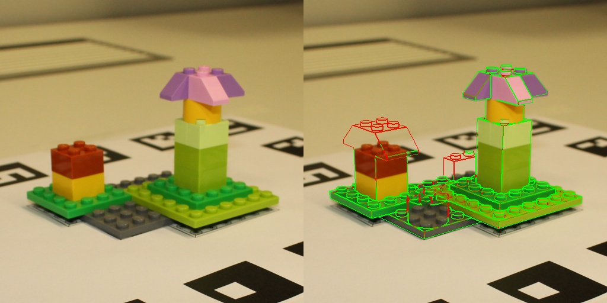
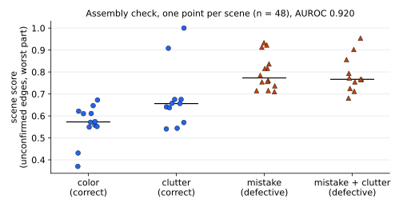

# Results

Moved from the top-level README, with the per-scenario detail that was in [`method.md`](method.md). Settings and
protocol: [`method.md`](method.md).

The PIXIE paper (Carl Zeiss AG, [arXiv 2607.16015](https://arxiv.org/abs/2607.16015)) shows that pose stays accurate
when the object is assembled wrong, but not whether it is assembled wrong. This repository reimplements the pose
pipeline (reference renders of the CAD model, SuperPoint + LightGlue matching with MINIMA weights, RANSAC PnP),
replaces the paper's given 2D detection with a localisation from the ArUco board, and adds the check: render the CAD
model at the estimated pose and test, part by part, whether the photo has a matching edge. Ground-truth poses are
never read at inference.

## Pose

695 images, one run (no spread across seeds or reference sets), RTX 4060. ADD = mean distance of model points (cm).

| | median ADD (cm) | mean ADD (cm) | ADD < 1 cm | ADD < 2 cm | rotation > 90 deg off |
| :-- | --: | --: | --: | --: | --: |
| PIXIE paper (RTX 4090, 2D detection given) | 0.36 | 1.12 | 73.5 % | | |
| This repo, no ground truth at inference | **0.32** | not recorded | **88.6 %** | 90.4 % | 7.2 % |
| This repo, crop from the gt pose (reference only) | 0.29 | not recorded | 94.4 % | 97.6 % | 1.6 % |

Paper values: Table III of the paper, PIXIE with the target model (median 0.3578 cm, mean 1.1172 cm, 73.53 % under
1 cm). This repository's mean ADD was not recorded: [`scripts/report.py`](../scripts/report.py) prints the median, as
the paper's text does, and the per-image results (`out/board_both.csv`) are not committed. Only the medians are
compared here; a mean would be pulled up by the gross failures (7.2 % of poses more than 90 deg off, 4 images
without a pose), as the paper's is.

## Assembly check

Same images, poses from the run above (AUROC, 0.5 = chance):

| | estimated pose | gt pose (analysis) |
| :-- | --: | --: |
| Scene: defective vs correct, all views pooled (25 / 23 scenes) | **0.920** | 0.955 |
| Single image | 0.846 | 0.881 |
| Single image, no clutter / clutter | 0.914 / 0.764 | 0.933 / 0.827 |
| Missing part, per image (AP 0.54, base rate 0.23) | 0.744 | 0.763 |

Extra bricks have no part-level label, so the part AUROC only measures missing parts.

*Left: photo. Right: CAD edges at the estimated pose; green = confirmed by the photo, red = not. The red bricks are
absent from the real assembly.*

## Pose per scenario and the scene scores

Pose without ground truth, ADD < 1 cm per scenario: color 96.2 %, clutter 88.8 %, assembly mistake 92.0 %, assembly mistake with clutter 75.3 %. The gap to the oracle crop (0.29 cm, 94.4 % < 1 cm) is almost entirely gross failures (rotation more than 90 deg off), mostly in cluttered scenes. 4 images get no pose. When the pose is right, it lines up with the photo to about 2 px (median reprojection error in the 512 px crop, [`scripts/reproj.py`](../scripts/reproj.py)).

*Per-scene scores from [`defect_scenes.csv`](defect_scenes.csv), plotted by [`scripts/make_fig_scene_scores.py`](../scripts/make_fig_scene_scores.py) (no dataset or GPU needed; prints scene AUROC 0.920). The two high correct scenes are `clutter2` of models 2 and 4.*

Pose error costs only a few points of AUROC. The main false positives are those two `clutter2` scenes, where the coarse pose failed: when nothing lines up, the check calls the scene defective. A pose-confidence gate would likely fix this, but it was not added after seeing these numbers. The check was tuned on synthetic defects only (part AUROC 0.94, image AUROC 0.83 there): images transfer well, part localisation loses ground on real photos.

Only the per-scene CSV is committed. The per-image pose and check outputs (`out/board_both.csv`, `out/defects_board/`) are produced by the commands in the [README](../README.md#run-it) but are not in the repository.
