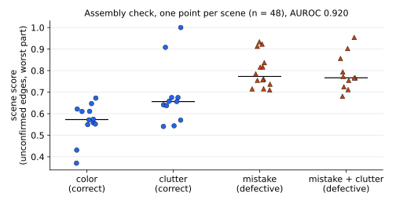

# Method details

The README gives the pipeline in one figure. This page lists the settings, with the file where each one lives.

## Pose (following the PIXIE paper)

1. Reference set ([`pixie/references.py`](../pixie/references.py)): the CAD model rendered from 121 directions x 8 in-plane rolls at 512 x 512 px, as normal maps and depth maps, with a small PyTorch rasteriser ([`pixie/render.py`](../pixie/render.py), no OpenGL). Each pixel keeps the model-frame 3D point under it.
2. Matching ([`pixie/matching.py`](../pixie/matching.py)): SuperPoint (2,048 keypoints) + LightGlue with MINIMA's cross-modal `sp_lg` weights, photo crop against every reference.
3. PnP ([`pixie/pose.py`](../pixie/pose.py)): matched reference keypoints are lifted to 3D; RANSAC PnP (1,000 iterations, 5 px in the crop) on the 5 references with the most matches, stopping early when at least half the matches are inliers.
4. View re-selection: the reference closest to the estimated viewpoint is also tried, and the pose with more inliers is kept.

## Where is the object?

The paper assumes the 2D detection is given. Here it comes from the scene, with no ground truth ([`pixie/detect.py`](../pixie/detect.py), `--box board` in [`scripts/run_eval.py`](../scripts/run_eval.py)):

- ArUco markers (`DICT_4X4_50`) on the board give the work area and, from their known side length, the expected image radius of the object.
- The markers are painted over with the surrounding paper colour so they do not attract matches.
- A coarse pose is estimated on the whole area with the normal-map references and 4,096 keypoints; the frozen pipeline then runs on a crop around the model projected at that pose.

## Assembly check ([`pixie/defects.py`](../pixie/defects.py))

- Render the target at the estimated pose in an undistorted crop. Its geometric edges (silhouette, depth steps > 2 mm, creases > 30 deg) are assigned to the part in front.
- An edge pixel is confirmed when the photo has a gradient of the same orientation within `tol_px`. A missing brick leaves its edges unconfirmed; what the camera sees there instead is a brick height away.
- Part score = share of unconfirmed edge support. Image score = worst part. Scene score: edge support pooled over all views of the scene first, then the same score.
- Parts are the connected components of the CAD mesh ([`pixie/parts.py`](../pixie/parts.py): studs, tubes, walls).

## Tuning, on synthetic data only

[`scripts/tune_defects.py`](../scripts/tune_defects.py) makes defects on the target model itself (bricks removed, added or moved on the LEGO grid), renders them as crude photos ([`pixie/synth.py`](../pixie/synth.py): flat brick colours, shading, paper background with loose bricks, blur, noise, JPEG) at a perturbed pose (about 3 px error, like the real estimator), and grid-searches 4 parameters on 480 views (120 per model). The result, `tol_px=2, norm_q=50, min_edge=20, region_mm=0`, was frozen before any real image was checked. On these synthetic defects the same parameters give part AUROC 0.94 and image AUROC 0.83.

## Protocol

The dataset is test-only.

- At inference: only the fully assembled target model, the camera calibration, the photo and the board marker size. The `modelN_poses.json` entry that places the object on the board is ground truth and is never read.
- Ground-truth poses and as-built meshes are used for scoring only. The `--box oracle` and `--gt-pose` options exist for analysis and are labelled as such in the README.
- No training or tuning on the dataset. The pose configuration (normal + depth references, matcher, RANSAC settings, coarse stage) was fixed before the full runs; a 12-image and a 24-image run served only to check that the code ran, and nothing was changed after them.
- External pretrained weights: SuperPoint and LightGlue/MINIMA, trained on other data; nothing is trained here.
- Defect labels (`missing()` in [`pixie/parts.py`](../pixie/parts.py), inspected with [`scripts/defect_labels.py`](../scripts/defect_labels.py)): the target parts with no identical part (same vertices) in the scene's as-built mesh. Extra bricks have no part-level label, so the part AUROC only measures missing parts.

## Results in more detail

Pose without ground truth, ADD < 1 cm per scenario: color 96.2 %, clutter 88.8 %, assembly mistake 92.0 %, assembly mistake with clutter 75.3 %. The gap to the oracle crop (0.29 cm, 94.4 % < 1 cm) is almost entirely gross failures (rotation more than 90 deg off), mostly in cluttered scenes. 4 images get no pose. When the pose is right, it lines up with the photo to about 2 px (median reprojection error in the 512 px crop, [`scripts/reproj.py`](../scripts/reproj.py)).

*Per-scene scores from [`defect_scenes.csv`](defect_scenes.csv), plotted by [`scripts/make_fig_scene_scores.py`](../scripts/make_fig_scene_scores.py) (no dataset or GPU needed; prints scene AUROC 0.920). The two high correct scenes are `clutter2` of models 2 and 4.*

Pose error costs only a few points of AUROC. The main false positives are those two `clutter2` scenes, where the coarse pose failed: when nothing lines up, the check calls the scene defective. A pose-confidence gate would likely fix this, but it was not added after seeing these numbers. The check was tuned on synthetic defects only (part AUROC 0.94, image AUROC 0.83 there): images transfer well, part localisation loses ground on real photos.

Only the per-scene CSV is committed. The per-image pose and check outputs (`out/board_both.csv`, `out/defects_board/`) are produced by the commands in the README but are not in the repository.

The check images in `docs/` come from `scripts/eval_defects.py` (renamed). The overview figure is hand-written SVG ([`figures/overview.svg`](figures/overview.svg)) with crops of `check_missing_model4.jpg`.
